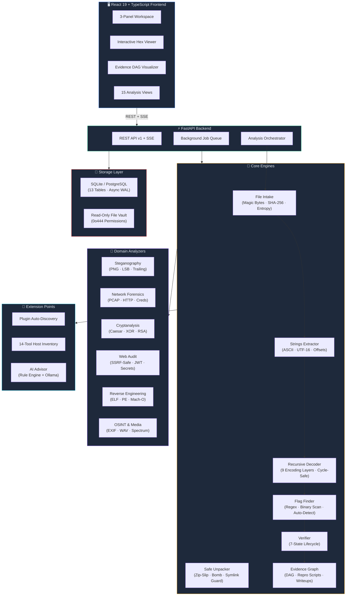
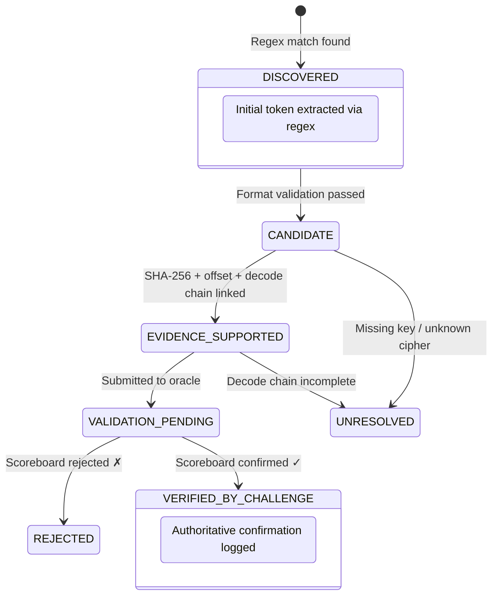

<p align="center">
  
</p>

<h1 align="center">CTF-PRO</h1>

<p align="center">
  <strong>Next-Generation Autonomous, Evidence-Based CTF Analysis & Flag Discovery Platform</strong>
</p>

<p align="center">
  <em>Zero simulation. Zero fake flags. Every finding cryptographically provable.</em>
</p>

<p align="center">
  <a href="https://www.python.org/"></a>
  <a href="https://fastapi.tiangolo.com/"></a>
  <a href="https://react.dev/"></a>
  <a href="https://www.typescriptlang.org/"></a>
  <a href="https://tailwindcss.com/"></a>
  <a href="LICENSE"></a>
</p>

<p align="center">
  <a href="#-quick-start"><strong>Quick Start</strong></a> ·
  <a href="docs/USER_GUIDE.md"><strong>User Guide</strong></a> ·
  <a href="docs/API_DOCS.md"><strong>API Docs</strong></a> ·
  <a href="docs/PLUGIN_GUIDE.md"><strong>Plugins</strong></a> ·
  <a href="docs/ARCHITECTURE.md"><strong>Architecture</strong></a> ·
  <a href="#-contributing"><strong>Contributing</strong></a>
</p>

<br />

<p align="center">
  
  
  
  
</p>

---

## Table of Contents

- [Why CTF-PRO?](#-why-ctf-pro)
- [Feature Highlights](#-feature-highlights)
- [System Architecture](#-system-architecture)
- [Quick Start](#-quick-start)
- [CLI Usage](#-command-line-interface)
- [Deployment Options](#-deployment-options)
- [Flag Discovery Lifecycle](#-flag-discovery-lifecycle)
- [Analysis Modules](#-analysis-modules)
- [Plugin System](#-plugin-system)
- [Test Suite](#-test-suite--quality-gates)
- [Security Posture](#-security-posture)
- [Comparison with Existing Tools](#-comparison-with-existing-tools)
- [Project Structure](#-project-structure)
- [Documentation](#-documentation)
- [Roadmap](#-roadmap)
- [Contributing](#-contributing)
- [License](#-license)

---

## 💡 Why CTF-PRO?

Most CTF toolkits are **collections of scripts** that produce unstructured output with no traceability. CTF-PRO is different — it's a **unified analysis workstation** built on three principles:

<table>
<tr>
<td width="33%" align="center">

### 🔬 Evidence-First

Every finding is anchored to a **source file SHA-256**, **exact byte offset**, and a **reproducible transformation chain**. No guessing. No hallucinated flags.

</td>
<td width="33%" align="center">

### 🛡️ Security-Hardened

Built-in **SSRF protection**, **Zip-Slip defense**, **decompression bomb limits**, **symlink trap rejection**, and **read-only file vaults**. Analysis never compromises the host.

</td>
<td width="33%" align="center">

### 🧩 Extensible by Design

Drop a `.py` file into `plugins/` and it's **auto-discovered** — no config files, no restarts. Full access to the analysis context and evidence graph.

</td>
</tr>
</table>

> **The Problem**: You download a CTF challenge file. You run `strings`, `binwalk`, `file`, `xxd` manually. You pipe outputs between terminals. You lose track of which offset produced which flag candidate. You can't reproduce your steps for the writeup.
>
> **The Solution**: CTF-PRO ingests the file, identifies its true type via magic bytes, recursively extracts archives, runs 7 domain analyzers in parallel, builds an evidence DAG linking every finding to its source, and generates a one-click reproduction script — all in one command.

---

## ✨ Feature Highlights

<table>
<tr><td>

**🔍 Intelligent Intake**
- Magic-byte detection for 30+ file formats
- SHA-256 fingerprinting & duplicate detection
- Entropy analysis & trailing-byte anomaly detection
- Recursive directory and archive traversal

</td><td>

**🧬 Multi-Layer Decoder**
- Recursive decode: Base64 → Base32 → Hex → ROT13 → Caesar → XOR → URL → HTML → ASCII
- Cycle-safe with hash-based loop prevention
- Full transformation chain recording
- Configurable depth limits & memory bounds

</td></tr>
<tr><td>

**🖼️ Steganography Analysis**
- PNG chunk structure audit (ancillary, critical, CRC)
- LSB extraction across RGB bitplanes
- Visual difference detection
- Trailing-byte payload recovery (post-IEND)

</td><td>

**🌐 Network Forensics**
- PCAP/PCAPNG TCP stream reassembly
- HTTP request/response carving
- Credential pattern matching
- Log normalization & timeline correlation

</td></tr>
<tr><td>

**🔐 Cryptanalysis Engine**
- Classical ciphers: Caesar, Atbash, Vigenère, ROT-N
- Single-byte & multi-byte XOR brute-force
- Frequency analysis & chi-squared scoring
- Weak RSA detection (small *e*, common *n*)
- Hash identification (MD5, SHA-1, SHA-256, bcrypt)

</td><td>

**⚙️ Reverse Engineering**
- ELF / PE / Mach-O header parsing
- Section table audit & suspicious API detection
- Embedded string extraction with offset mapping
- Static analysis only — never executes binaries

</td></tr>
<tr><td>

**🌍 Web & OSINT**
- SSRF-safe HTTP client with strict IP validation
- Static HTML/JS secret detection (API keys, tokens, JWTs)
- EXIF metadata extraction & GPS coordinate mapping
- WAV/MP3/MP4 spectral and envelope analysis

</td><td>

**📊 Reporting & Export**
- HTML, JSON, CSV, and PDF export
- GitHub Flavored Markdown writeup generation
- Standalone Python reproduction scripts
- Evidence DAG visualization
- Smart triage with severity ranking

</td></tr>
</table>

---

## 🏛️ System Architecture



---

## 🚀 Quick Start

### Prerequisites

| Requirement | Version | Purpose |
|---|---|---|
| Python | 3.11+ | Backend runtime |
| Node.js | 18+ | Frontend build |
| Git | 2.x | Version control |

### Get Running in 60 Seconds

```bash
# Clone
git clone https://github.com/nanthishvaran17/CTF-PRO.git
cd CTF-PRO

# Backend
pip install -r requirements.txt && pip install -e .

# Frontend
cd frontend && npm install && npm run build && cd ..

# Launch
python -m uvicorn backend.ctfx.main:app --host 127.0.0.1 --port 8000
```

Open **http://127.0.0.1:8000** — you're analyzing files.

---

## ⌨️ Command-Line Interface

CTF-PRO ships a zero-config CLI for terminal-first workflows:

```bash
# Deep-analyze a challenge file
ctfx analyze /path/to/challenge.bin

# Audit installed host tools
ctfx tools
```

<details>
<summary><strong>📋 Example Output</strong> (click to expand)</summary>

```
[*] Ingesting target: trailing_payload.png
    - SHA-256: 88d8e58fb16c30e20e177d061459ba6fd0e52e2d1e4114278f8ba736282bfa27
    - Size: 122 bytes
    - True Magic Type: PNG (PNG binary file)
    - Entropy: 5.3735/8.0
    [!] Anomaly: Found 32 trailing bytes beyond boundary!

[*] Scanning printable strings with exact byte offsets...
    - Extracted 5 strings.

[+] Flag Discovery Complete. Discovered candidates:
    #1 Flag: FLAG{trailing_iend_detected} (offset: 92, method: direct_strings)
        Evidence: SHA-256 anchored, 1 decode step, reproducible
    #2 Flag: FLAG{trailing_iend_detected} (offset: 92, method: multilayer_decode)
        Evidence: SHA-256 anchored, 3 decode steps, reproducible
```

</details>

---

## 📦 Deployment Options

| Method | Command | Best For | Requirements |
|---|---|---|---|
| **🖥️ Native** | `uvicorn backend.ctfx.main:app` | Development, local CTFs | Python 3.11+, Node 18+ |
| **🐳 Docker** | `docker compose up --build` | Isolated environments, CI | Docker Engine |
| **🪟 Windows** | `.\scripts\run_windows.ps1` | Windows workstations | PowerShell 5.1+ |
| **🐧 Linux/macOS** | `./scripts/run_linux.sh` | Kali, Ubuntu, macOS | Bash |

<details>
<summary><strong>Docker Compose Details</strong></summary>

```bash
# Build and start all services
docker compose up --build

# Run in background
docker compose up -d --build

# View logs
docker compose logs -f

# Stop
docker compose down
```

Navigate to `http://localhost:8000` after startup.

</details>

---

## 🚦 Flag Discovery Lifecycle

Flags progress through a **strict 7-state machine**. A flag is **never** marked `VERIFIED` without authoritative confirmation from the challenge scoreboard or organizer:



| State | Meaning | Evidence Required |
|---|---|---|
| 🔵 `DISCOVERED` | Raw regex match | Pattern + source file |
| 🟡 `CANDIDATE` | Format-validated | String sanity + entropy check |
| 🟢 `EVIDENCE-SUPPORTED` | Cryptographically anchored | SHA-256 + byte offset + decode chain |
| 🟠 `VALIDATION-PENDING` | Awaiting oracle | Submission timestamp |
| ✅ `VERIFIED-BY-CHALLENGE` | Authoritatively confirmed | Scoreboard response logged |
| 🔴 `REJECTED` | Explicitly invalidated | Rejection reason logged |
| ⚪ `UNRESOLVED` | Incomplete analysis | Missing decryption key or stage |

---

## 🧪 Analysis Modules

<table>
<tr>
<td align="center" width="14%">

**🖼️**<br/>Steganography

</td>
<td align="center" width="14%">

**🌐**<br/>Network Forensics

</td>
<td align="center" width="14%">

**🔐**<br/>Cryptanalysis

</td>
<td align="center" width="14%">

**🌍**<br/>Web Audit

</td>
<td align="center" width="14%">

**⚙️**<br/>Reverse Engineering

</td>
<td align="center" width="14%">

**📡**<br/>OSINT & Media

</td>
<td align="center" width="14%">

**🔌**<br/>Plugins

</td>
</tr>
<tr>
<td>

PNG chunks<br/>LSB extraction<br/>Trailing bytes<br/>Visual diff

</td>
<td>

PCAP streams<br/>HTTP carving<br/>Credential hunt<br/>Log normalize

</td>
<td>

Caesar/ROT/Vigenère<br/>XOR brute-force<br/>Frequency analysis<br/>Weak RSA

</td>
<td>

SSRF-safe client<br/>JWT discovery<br/>API key detection<br/>HTML secrets

</td>
<td>

ELF/PE/Mach-O<br/>Section audit<br/>Suspicious APIs<br/>Static only

</td>
<td>

EXIF GPS<br/>WAV spectrum<br/>MP4 metadata<br/>Envelope FFT

</td>
<td>

Auto-discovery<br/>Hot reload<br/>Context access<br/>Custom types

</td>
</tr>
</table>

---

## 🔌 Plugin System

Extend CTF-PRO with zero configuration. Drop a Python file into `plugins/` — it's auto-discovered on startup:

```python
from pathlib import Path
from typing import Dict, Any, Optional
from backend.ctfx.plugins.base import AnalyzerPlugin

class CustomXORDetector(AnalyzerPlugin):
    name = "CustomXORDetector"
    version = "1.0.0"
    author = "YourTeam"
    description = "Detects single-byte XOR encoded payloads"
    supported_types = ["*"]  # Run on all file types

    def analyze(self, file_path: Path, context: Optional[Dict[str, Any]] = None) -> Dict[str, Any]:
        data = file_path.read_bytes()[:4096]
        results = []
        for key in range(1, 256):
            decoded = bytes(b ^ key for b in data)
            if b"FLAG{" in decoded:
                results.append({"xor_key": hex(key), "decoded_preview": decoded[:64].decode(errors="replace")})
        return {"xor_candidates": results, "bytes_scanned": len(data)}
```

> 📖 Full guide: [Plugin Authoring Guide](docs/PLUGIN_GUIDE.md)

---

## ✅ Test Suite & Quality Gates

24 tests across 4 categories — every PR must pass all gates:

```
$ python -m pytest tests/ -v

tests/test_api.py::test_full_api_workflow                          PASSED  [  4%]
tests/test_core_engines.py::test_file_intake_magic_and_entropy     PASSED  [  8%]
tests/test_core_engines.py::test_strings_extractor_with_offsets    PASSED  [ 12%]
tests/test_core_engines.py::test_multilayer_decoder_chains          PASSED  [ 16%]
tests/test_core_engines.py::test_archive_zip_slip_and_bomb_protection PASSED [ 20%]
tests/test_core_engines.py::test_flag_finder_and_verifier          PASSED  [ 25%]
tests/test_core_engines.py::test_repro_script_and_writeup          PASSED  [ 29%]
tests/test_fixtures_suite.py::test_clean_file_reports_nothing      PASSED  [ 33%]
tests/test_fixtures_suite.py::test_planted_multilayer_encoded_flag PASSED  [ 37%]
tests/test_fixtures_suite.py::test_planted_lsb_stego_png           PASSED  [ 41%]
tests/test_fixtures_suite.py::test_trailing_bytes_png              PASSED  [ 45%]
tests/test_fixtures_suite.py::test_nested_zip_extraction           PASSED  [ 50%]
tests/test_fixtures_suite.py::test_pcap_http_stream_reconstruction PASSED  [ 54%]
tests/test_fixtures_suite.py::test_elf_binary_strings_and_arch     PASSED  [ 58%]
tests/test_modules.py::test_stego_png_and_lsb                     PASSED  [ 62%]
tests/test_modules.py::test_forensics_pcap_reconstruction          PASSED  [ 66%]
tests/test_modules.py::test_crypto_analysis                        PASSED  [ 70%]
tests/test_modules.py::test_web_ssrf_blocking                      PASSED  [ 75%]
tests/test_modules.py::test_reverse_engineering_elf                PASSED  [ 79%]
tests/test_modules.py::test_plugin_discovery_and_execution         PASSED  [ 83%]
tests/test_modules.py::test_tool_inventory_detection               PASSED  [ 87%]
tests/test_security_bounds.py::test_zip_slip_traversal             PASSED  [ 91%]
tests/test_security_bounds.py::test_archive_bomb_limits            PASSED  [ 95%]
tests/test_security_bounds.py::test_ssrf_protection_subnets        PASSED  [100%]
========================= 24 passed in 2.06s =========================
```

| Category | Tests | Coverage |
|---|---|---|
| **Core Engines** | 6 | Intake, strings, decoder, archive, flags, evidence |
| **Domain Modules** | 7 | Stego, forensics, crypto, web, RE, plugins, tools |
| **Fixture Assertions** | 7 | Real files with exact hash and offset verification |
| **Security Boundaries** | 3 | Zip-Slip, decompression bombs, SSRF subnets |
| **API Integration** | 1 | Full end-to-end REST workflow |

---

## 🔒 Security Posture

| Threat Vector | Mitigation | Implementation |
|---|---|---|
| **Zip-Slip path traversal** | Path validation + directory confinement | [`archive.py`](backend/ctfx/engines/archive.py) |
| **Decompression bombs** | Configurable size limits per entry and total | [`archive.py`](backend/ctfx/engines/archive.py) |
| **Symlink traps** | Symlink rejection in archive extraction | [`archive.py`](backend/ctfx/engines/archive.py) |
| **SSRF attacks** | Block loopback, RFC 1918, link-local, metadata IPs | [`web.py`](backend/ctfx/modules/web.py) |
| **Arbitrary code execution** | Static-only binary analysis, never executes uploads | [`re.py`](backend/ctfx/modules/re.py) |
| **Memory exhaustion** | Streaming reads, bounded decode depth, entropy caps | [`decoder.py`](backend/ctfx/engines/decoder.py) |
| **Fake/hallucinated flags** | 7-state lifecycle, no `VERIFIED` without oracle | [`verifier.py`](backend/ctfx/engines/verifier.py) |

> 📖 Full threat model: [THREAT_MODEL.md](docs/THREAT_MODEL.md) · Security policy: [SECURITY.md](SECURITY.md)

### Honest Limitations

- **Classical crypto only** — AES, ChaCha, and modern symmetric ciphers require the key; reported as `UNRESOLVED`
- **No dynamic RE** — binaries are never executed; analysis is header/string/section-level only
- **Tool fallbacks** — when `binwalk`, `tshark`, or `exiftool` are missing, pure-Python alternatives run (functionally equivalent but slower)
- **No internet scanning** — authorized local files and environments only

---

## 📊 Comparison with Existing Tools

| Capability | CTF-PRO | pwntools | CyberChef | Autopsy | binwalk |
|---|:---:|:---:|:---:|:---:|:---:|
| Evidence provenance (SHA-256 + offset) | ✅ | ❌ | ❌ | ✅ | ❌ |
| Multi-layer recursive decoding | ✅ | ❌ | ✅ | ❌ | ❌ |
| Integrated web UI | ✅ | ❌ | ✅ | ✅ | ❌ |
| SSRF-safe web analysis | ✅ | ❌ | ❌ | ❌ | ❌ |
| Archive safety (Zip-Slip / bomb) | ✅ | ❌ | ❌ | ⚠️ | ⚠️ |
| Flag lifecycle state machine | ✅ | ❌ | ❌ | ❌ | ❌ |
| Plugin auto-discovery | ✅ | ❌ | ❌ | ✅ | ❌ |
| Reproduction scripts | ✅ | ❌ | ❌ | ❌ | ❌ |
| REST API + SSE streaming | ✅ | ❌ | ❌ | ✅ | ❌ |
| Writeup generation | ✅ | ❌ | ❌ | ❌ | ❌ |
| Zero-config local mode | ✅ | ✅ | ✅ | ❌ | ✅ |
| Cross-platform (Win/Linux/Mac) | ✅ | ⚠️ | ✅ | ⚠️ | ✅ |

---

## 📁 Project Structure

```
CTF-PRO/
├── backend/
│   └── ctfx/
│       ├── api/v1/          # REST API endpoints (FastAPI)
│       ├── core/            # Orchestrator, event bus
│       ├── db/              # SQLAlchemy models, async session
│       ├── engines/         # Core analysis engines
│       │   ├── intake.py    #   File intake, magic bytes, SHA-256
│       │   ├── strings.py   #   String extraction with offsets
│       │   ├── decoder.py   #   Multi-layer recursive decoder
│       │   ├── archive.py   #   Safe unpacker (Zip-Slip guard)
│       │   ├── flag_finder.py #  Regex + binary flag scanner
│       │   ├── verifier.py  #   7-state lifecycle manager
│       │   └── evidence.py  #   DAG builder, repro scripts
│       ├── modules/         # Domain analyzers
│       │   ├── stego.py     #   Steganography (PNG, LSB)
│       │   ├── forensics.py #   PCAP, HTTP, credentials
│       │   ├── crypto.py    #   Classical ciphers, XOR, RSA
│       │   ├── web.py       #   SSRF-safe web audit
│       │   ├── re.py        #   ELF/PE/Mach-O static analysis
│       │   ├── osint.py     #   EXIF, GPS, metadata
│       │   └── media.py     #   WAV, MP3, MP4 analysis
│       ├── plugins/         # Plugin base class & loader
│       ├── tools/           # Host tool inventory & AI advisor
│       ├── reporting/       # HTML/JSON/CSV/PDF exporter
│       ├── main.py          # FastAPI application entry
│       ├── cli.py           # CLI (ctfx analyze / ctfx tools)
│       └── config.py        # Pydantic settings
├── frontend/
│   └── src/
│       ├── components/      # HexViewer, EvidenceGraph, Workspace
│       ├── pages/           # 13 analysis views
│       ├── api/             # REST client + SSE subscription
│       └── App.tsx          # Router + keyboard shortcuts
├── plugins/                 # User plugins (auto-discovered)
├── tests/
│   ├── fixtures/            # Real test files (PNG, ZIP, PCAP, ELF)
│   ├── test_core_engines.py # 6 engine tests
│   ├── test_modules.py      # 7 module tests
│   ├── test_fixtures_suite.py # 7 fixture assertion tests
│   ├── test_security_bounds.py # 3 security boundary tests
│   └── test_api.py          # 1 integration test
├── docs/                    # Architecture, threat model, guides
├── docker/                  # Dockerfile + docker-compose.yml
├── scripts/                 # Cross-platform launch scripts
├── .github/workflows/       # CI pipeline
├── pyproject.toml           # Python package config
├── requirements.txt         # Python dependencies
└── .env.example             # Environment template
```

---

## 📚 Documentation

| Document | Description |
|---|---|
| 📐 [Architecture](docs/ARCHITECTURE.md) | System design, data flow, module boundaries |
| 🛡️ [Threat Model](docs/THREAT_MODEL.md) | Attack surface analysis and defense controls |
| 📘 [User Guide](docs/USER_GUIDE.md) | Walkthroughs, keyboard shortcuts, workflows |
| 💻 [Developer Guide](docs/DEVELOPER_GUIDE.md) | Setup, code standards, testing practices |
| 🔌 [Plugin Guide](docs/PLUGIN_GUIDE.md) | Authoring custom analyzers |
| 📡 [API Reference](docs/API_DOCS.md) | REST endpoints, request/response schemas |
| 🔧 [Troubleshooting](docs/TROUBLESHOOTING.md) | Common issues and fixes |

---

## 🗺️ Roadmap

| Phase | Status | Description |
|---|---|---|
| Core Engines | ✅ Done | Intake, strings, decoder, archive, flags, verifier, evidence |
| Domain Modules | ✅ Done | Stego, forensics, crypto, web, RE, OSINT, media |
| REST API + SSE | ✅ Done | 25 endpoints, background jobs, real-time events |
| React Frontend | ✅ Done | 3-panel workspace, hex viewer, evidence graph |
| Plugin System | ✅ Done | Auto-discovery, hot reload, context injection |
| Test Suite (24/24) | ✅ Done | Core, modules, fixtures, security, integration |
| Docker + Scripts | ✅ Done | Cross-platform deployment |
| Documentation | ✅ Done | Architecture, threat model, 5 guides |
| PostgreSQL Remote Mode | 🔲 Planned | Multi-user auth, sessions, CSRF, rate limits |
| AI Triage Enhancement | 🔲 Planned | LLM-powered hypothesis ranking via Ollama |
| PDF Report Styling | 🔲 Planned | Professional PDF export with charts |
| Collaborative Mode | 🔲 Planned | Real-time team analysis with WebSocket sync |

---

## 🤝 Contributing

Contributions are welcome! Please read the [Contributing Guide](CONTRIBUTING.md) before submitting a PR.

```bash
# Fork and clone
git clone https://github.com/<your-username>/CTF-PRO.git
cd CTF-PRO

# Create a feature branch
git checkout -b feat/your-feature

# Run tests before submitting
python -m pytest tests/ -v
cd frontend && npm run build

# Push and open a PR
git push origin feat/your-feature
```

---

## 📄 License

Released under the [MIT License](LICENSE).

Built with ❤️ by [Nanthishvaran](https://github.com/nanthishvaran17)

---

<p align="center">
  <strong>⚔️ CTF HUNTER X — Real analysis. Real evidence. Real flags.</strong>
</p>

<p align="center">
  <a href="https://github.com/nanthishvaran17/CTF-PRO">
    
  </a>
</p>
